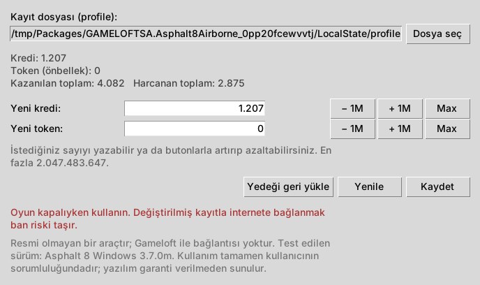

# Asphalt 8 Kayıt Düzenleyici

> ⚠️ **Resmi olmayan bir araçtır.** Gameloft veya Microsoft ile bağlantısı yoktur. Yalnızca kişisel, tek oyunculu ve çevrimdışı kullanım içindir. Kullanım tamamen kendi sorumluluğunuzdadır, ayrıntılar için [Sorumluluk Reddi](#sorumluluk-reddi) bölümüne bakın.

Asphalt 8: Airborne'un **Windows** sürümündeki yerel kayıt dosyasında **kredi** ve **token (mavi coin)** değerlerini değiştiren, pencereli arayüzü olan küçük bir Python programı.



## Test edilen sürüm

| | |
|---|---|
| Oyun | Asphalt 8: Airborne |
| Platform | Windows 10 (Microsoft Store / UWP, x86) |
| Sürüm | **3.7.0m** (paket 3.7.0.12) |

Başka sürümlerde kayıt dosyası tanınmazsa program **hiçbir şeyi değiştirmeden** durur ve hata mesajı verir.

## Özellikler

- Pencereli arayüz: istediğiniz miktarı yazın ya da **− 1M / + 1M / Max** butonlarını kullanın
- Kayıt dosyasını otomatik bulur
- Her değişiklikten önce **zaman damgalı yedek** alır, tek tuşla geri yüklenir
- Oyun açıksa değişiklik yapmayı reddeder
- Kaydetmeden önce yeni dosyayı tekrar açıp doğrular
- 32 bit sınırını aşan değerleri otomatik olarak düşürür
- Ek kütüphane gerekmez, tek dosyadır

## Gereksinimler

- Windows 10 veya 11
- [Python 3.8+](https://www.python.org/downloads/). Windows kurulumunda arayüz için gereken **tkinter** hazır gelir.

## Kullanım

1. Asphalt 8'i **tamamen kapatın**.
2. `a8_kayit_duzenleyici.py` dosyasına çift tıklayın (veya `python a8_kayit_duzenleyici.py`).
3. Yeni kredi/token değerini girin ve **Kaydet**'e basın.
4. Oyunu **internete bağlamadan** açın.

Bir sorun olursa **Yedeği geri yükle** butonu önceki hâli geri getirir. Yedekler kayıt dosyasının yanında `profile.yedek_...` adıyla durur.

### Komut satırı

```bash
python a8_kayit_duzenleyici.py --goster                     # mevcut değerleri göster
python a8_kayit_duzenleyici.py --kredi 1000000 --token 5000  # değerleri değiştir
python a8_kayit_duzenleyici.py --geri-yukle                 # en son yedeği geri yükle
python a8_kayit_duzenleyici.py --dosya "C:\yol\profile" --kredi 500000
```

Kayıt dosyası genellikle şuradadır:

```
%LOCALAPPDATA%\Packages\GAMELOFTSA.Asphalt8Airborne_0pp20fcewvvtj\LocalState\profile
```

## Sık sorulanlar

**Neden en fazla ~2 milyar?**
Oyun bu değerleri 32 bitlik tam sayı olarak saklıyor (en fazla 2.147.483.647). Daha büyük bir değer taşar ve eksiye düşer. Program, sonradan kazanılan krediler de taşmasın diye 2.047.483.647'de sınırlar.

**Token görünmüyor/harcanmıyor?**
Kayıttaki token alanı yerel bir *önbellek*. Asıl bakiye sunucuda tutuluyor olabilir, bu yüzden token her zaman çalışmayabilir.

**Neden internete bağlanmamalıyım?**
Sunucu bakiyeyi düzeltebilir veya hesabı işaretleyip yasaklayabilir.

**Cheat Engine ile neden bulunamıyor?**
Oyun çalışırken krediyi bellekte büyük ihtimalle karıştırılmış (şifrelenmiş) bir biçimde tutuyor. Bu yüzden ekrandaki sayıyı doğrudan aramak sonuç vermiyor. Kayıt dosyasında ise değer şifreli ama düz sayı olarak duruyor.

## Nasıl çalışır?

Kayıt dosyası birlikte çalışabilirlik amacıyla incelenmiştir:

- `profile` dosyası, bozulmaya karşı aynı kaydın birkaç kopyasını içerir. Her kopyanın CRC32 değeri ve uzunluğu ayrıca saklanır.
- Kayıt: `0xED` başlığı, bayrak ve boyutlar, ardından **XTEA-ECB** (32 tur) ile şifreli veri.
- Çözülen veri bir anahtar–değer listesidir (`playerMoney`, `playerCachedHardCurrency` vb.) ve başında kendi CRC32'si bulunur.
- Program ilgili alanları değiştirir, tüm CRC'leri yeniden hesaplar ve bütün kopyaları günceller. Tutarlılık için `playerMoneyGained` alanı da `kredi + harcanan` olarak ayarlanır.

Depoda oyuna ait hiçbir kod, dosya veya içerik bulunmaz.

## Sorumluluk Reddi

- Bu proje bağımsız, resmi olmayan bir hobi/eğitim projesidir. **Gameloft SE** veya **Microsoft** ile hiçbir bağlantısı yoktur. Bu şirketler tarafından onaylanmamış, desteklenmemiş veya sponsor olunmamıştır.
- "Asphalt" ve "Asphalt 8: Airborne" Gameloft SE'nin ticari markalarıdır. Bu adlar yalnızca uyumluluğu belirtmek için kullanılmıştır.
- Yazılım oyuna ait hiçbir kod, dosya, görsel veya içerik barındırmaz ve dağıtmaz. Yalnızca kullanıcının kendi bilgisayarındaki, kendisine ait kayıt dosyası üzerinde çalışır.
- Yalnızca kişisel, tek oyunculu ve çevrimdışı kullanım içindir. Çok oyunculu modlarda, çevrimiçi etkinliklerde veya başka oyunculara karşı haksız avantaj sağlamak amacıyla kullanılmamalıdır.
- Kayıt dosyasını değiştirmek oyunun kullanım koşullarına aykırı olabilir ve hesabın askıya alınmasına, yasaklanmasına veya ilerlemenin kaybına yol açabilir. Kullanıp kullanmamak ve tüm sonuçları **tamamen kullanıcının sorumluluğundadır**.
- Yazılım **"OLDUĞU GİBİ"** sunulur. Çalışacağına, hatasız olduğuna veya belirli bir amaca uygun olduğuna dair hiçbir garanti verilmez. Yazar; veri kaybı, hesap yasağı veya başka herhangi bir doğrudan ya da dolaylı zarardan sorumlu tutulamaz.
- Hak sahibi bir şirketin talebi hâlinde proje kaldırılacaktır.

### Disclaimer (EN)

Unofficial fan/educational project, not affiliated with or endorsed by Gameloft SE or Microsoft. "Asphalt" is a trademark of Gameloft SE. This repository contains no game code or assets; the tool only edits the user's own local save file for personal, offline, single-player use. Modifying saves may violate the game's terms of service and lead to bans. Provided "AS IS", without warranty of any kind. The author accepts no liability for any damage. Use at your own risk. The project will be taken down upon request by the rights holder.

## Lisans

[MIT](LICENSE)
